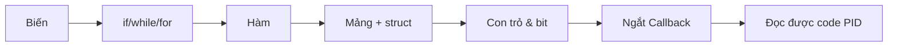
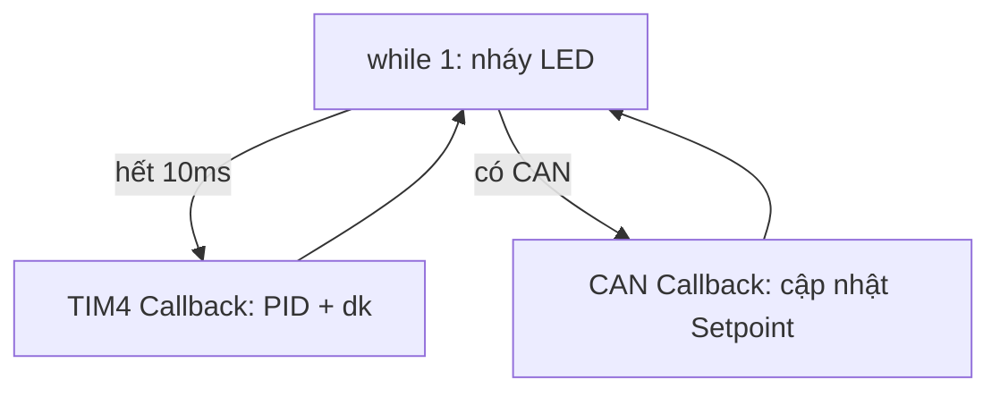

# LỆNH CƠ BẢN STM32 — Giáo án từ số 0

> **Mục tiêu:** Nắm 10 cấu trúc C đủ để đọc + viết code cho mạch PID `RBC2026_PID_BOARD_R1` (STM32F103C8T6, LED PC13_1, TIM2 PWM, TIM3 Encoder, TIM4 10ms, CAN, USART2).
> **Cách học:** Mỗi mục có 6 phần: *Hiểu 1 câu → Cú pháp → Ví dụ thật trên mạch PID → Quy tắc → Lỗi hay gặp → Bài tập 2 phút.*
> **Project đối chiếu:** `/home/ngxhwng/Downloads/ROBOCON/codeR1 - mạch PID/Core/Src/main.c`
> **Thực hành đi kèm:** [[Thực hành - Nháy LED PC13_1]] · Canvas: [[Bản đồ C cho STM32]]



---

## 1. BIẾN — Ô nhớ cất số

> [!tip] Hiểu 1 câu
> Biến = 1 ô nhớ RAM có **tên + kiểu + giá trị**. Muốn cất số gì thì phải báo trước nó to bao nhiêu.

### 1.1 Bảng 4 kiểu dùng 99% trên STM32F103

| Kiểu | Miền giá trị | Tốn RAM | Dùng khi nào (mạch PID) |
|---|---|---|---|
| `uint8_t` | 0 ~ 255 | 1 byte | Byte CAN `RxData[8]`, id motor 1-6, `l = 0/1` |
| `int` (`int32_t`) | -2 tỉ ~ +2 tỉ | 4 byte | `Setpoint -333~333`, xung encoder `xung` |
| `uint32_t` | 0 ~ 4 tỉ | 4 byte | `HAL_GetTick()`, `Period = 7199`, `t0` |
| `float` | số lẻ ~7 chữ số | 4 byte | `Kp=1.5, Ki=0.003, output, speed, Delta_t` |

### 1.2 Cú pháp

```c
// khai báo + gán
uint8_t id = 1;
volatile int Setpoint = 0;
float Delta_t = 0.01;
float output = 0;

// khai báo không gán -> rác, phải gán sau
int xung_trc;
xung_trc = 0;
```

### 1.3 Ví dụ thật (code PID cũ của bạn)

```c
uint8_t RxData[8];          // 8 byte CAN nhận về
CAN_RxHeaderTypeDef RxHeader;
float output, vt;
float Delta_t = 0.01;       // chu kỳ PID 10ms
volatile int Setpoint;      // tốc độ đặt, ngắt CAN sửa, while đọc
```

### 1.4 Quy tắc vàng

1. **Đếm, thời gian, PWM → `int/uint32_t`. Tính chia PID → `float`.**
2. **Biến vừa dùng trong ngắt vừa dùng trong `while` → thêm `volatile`.** Không có là tối ưu sai.
   ```c
   volatile int Setpoint; // CAN_RX sửa, TIM4 đọc
   ```
3. **Biến toàn cục để ở `USER CODE BEGIN PV`, biến tạm để trong hàm.**
4. `uint8_t` cộng quá 255 sẽ **tràn về 0**. `int` gán `333.7` sẽ **mất phần lẻ**.

> [!warning] Lỗi hay gặp
> - Quên `volatile` → `while` đọc số cũ mãi, motor không đổi tốc.
> - Dùng `float` để đếm xung `xung++` → chậm, tốn Flash F103.
> - Khai báo `int t = HAL_GetTick();` trong `while` → mỗi vòng tạo mới, phí stack.

### 1.5 Bài tập 2 phút

```c
// Trong USER CODE BEGIN PV thêm:
uint8_t dem = 0;
// Trong while(1):
HAL_GPIO_TogglePin(LED_GPIO_Port, LED_Pin);
dem++; // nháy 256 lần thì tràn về 0, tính xem bao lâu nếu delay 500ms?
HAL_Delay(500);
```

---

## 2. `#define` / `const` / `enum` — Đặt tên cho số

> [!tip] Hiểu 1 câu
> Đừng để số trần `333, 7199` rải khắp code. Đặt tên cho nó để sau đổi 1 chỗ.

```c
// CubeMX sinh trong main.h:
#define LED_Pin GPIO_PIN_13
#define LED_GPIO_Port GPIOC

// Bạn tự thêm:
#define SETPOINT_MAX 333
#define PWM_MAX 7199
const float Ks = 3.2; // hằng số, gán lại là lỗi biên dịch

// enum: nhóm các lựa chọn
typedef enum {
  AUTOTUNE_STATE_IDLE = 0,
  AUTOTUNE_STATE_INIT,
  AUTOTUNE_STATE_RUNNING,
  AUTOTUNE_STATE_SUCCESS
} AutoTuneState;
```

> [!example] Dùng
> ```c
> if (Setpoint > SETPOINT_MAX) Setpoint = SETPOINT_MAX;
> __HAL_TIM_SET_COMPARE(&htim2, TIM_CHANNEL_1, PWM_MAX);
> ```

**Quy tắc:** Tên `#define` viết HOA + gạch dưới. Số nào xuất hiện 2 lần trở lên → define nó.

---

## 3. `if - else` / `switch` — Ra quyết định

> [!tip] Hiểu 1 câu
> Nếu điều kiện đúng thì làm A, không thì làm B.

```c
if (Setpoint > 0) {
  quay_thuan();
} else if (Setpoint < 0) {
  quay_nghich();
} else {
  dung(); // Setpoint == 0
}

// Chống vượt giới hạn - gặp hoài trong PID:
if (output > 7199) output = 7199;
else if (output < -7199) output = -7199;

// switch: khi có nhiều mode rõ ràng
switch (id) {
  case 1: Setpoint = 150; break;
  case 2: Setpoint = -150; break;
  default: Setpoint = 0; break; // nhớ break, quên là chạy lọt xuống dưới
}
```

**Toán tử hay dùng:** `> < >= <= == !=` , `&&` (và), `||` (hoặc), `!` (phủ định).

```c
if (abs_setpoint < 20.0f && setpoint != 0) { Kp_active *= 0.9f; }
```

> [!warning] Lỗi kinh điển
> `if (a = 1)` là **gán**, luôn đúng. Phải là `if (a == 1)` mới là **so sánh**.

---

## 4. `while` / `for` — Lặp

> [!tip] Hiểu 1 câu
> `while(1)` = lặp mãi mãi (chương trình chính). `for` = lặp số lần biết trước.

```c
// 4.1 Chương trình chính - bắt buộc có
while (1) {
  HAL_GPIO_TogglePin(LED_GPIO_Port, LED_Pin);
  HAL_Delay(500);
}

// 4.2 for: quét 6 motor, gửi 8 byte CAN
for (int i = 0; i < 8; i++) {
  RxData[i] = 0;
}
for (int i = 0; i < 6; i++) {
  // xử lý motor i+1
}

// 4.3 Test 10 giây không dùng delay chặn ngắt (mẫu code cũ của bạn):
uint32_t t0 = HAL_GetTick();
while (HAL_GetTick() - t0 < 10000) {
  read_encoder();
  HAL_Delay(10);
}
```

**`break` / `continue`:**
```c
for (int i = 0; i < 100; i++) {
  if (i == 5) continue; // bỏ qua 5
  if (i == 10) break;   // dừng hẳn
}
```

---

## 5. HÀM — Chia việc to thành việc nhỏ

> [!tip] Hiểu 1 câu
> Hàm = máy có đầu vào (tham số) và đầu ra (`return`). Viết 1 lần, gọi nhiều lần.

```c
// Không vào, không ra:
void dung(void) {
  __HAL_TIM_SET_COMPARE(&htim2, TIM_CHANNEL_1, 0);
  __HAL_TIM_SET_COMPARE(&htim2, TIM_CHANNEL_2, 0);
}

// Có vào, có ra:
int gioi_han(int x) {
  if (x > 333) return 333;
  if (x < -333) return -333;
  return x;
}

// Gọi:
dung();
Setpoint = gioi_han(Setpoint);

// Hàm PID chuẩn:
void PID_Control(PID_CONTROL *pid, int setpoint);
void dk(void); // chọn chiều quay theo dấu output
void read_encoder(void);
```

**Quy tắc:**
1. Tên hàm là động từ: `read_`, `tinh_`, `dieu_khien_`.
2. Hàm dài quá 30 dòng → tách nhỏ.
3. Khai báo mẫu (prototype) ở `.h`, viết thân ở `.c`.

---

## 6. MẢNG — Dãy ô nhớ giống nhau

```c
uint8_t RxData[8]; // 8 ô: RxData[0] ... RxData[7]
RxData[6] // byte chứa dấu trong code CAN cũ
RxData[id - 1] // byte tốc độ của motor id

// Xóa mảng:
for (int i = 0; i < 8; i++) RxData[i] = 0;

// Chuỗi ký tự để debug UART:
char msg[128];
int len = snprintf(msg, sizeof(msg), "speed=%ld\r\n", (long)speed);
HAL_UART_Transmit(&huart2, (uint8_t*)msg, len, 100);
```

> [!warning] Tràn mảng là lỗi treo chip số 1
> `RxData[8]` chỉ tới `[7]`. Ghi `RxData[8] = 1` là ghi đè RAM khác → HardFault.

---

## 7. `struct` + `typedef` — Hộp đựng nhiều biến

> [!tip] Hiểu 1 câu
> `struct` là cái hộp đựng nhiều biến khác loại. `typedef` đặt tên ngắn cho hộp đó. HAL dùng toàn kiểu này.

```c
typedef struct {
  volatile float Kp, Ki, Kd;
  volatile float er, pre_er;
  volatile float i, d;
  volatile float gtht;
} Pid_data;

typedef struct {
  volatile float speed;
  volatile long xung;
  volatile long xung_trc;
  volatile long xung_tmp;
} Encoder_data;

typedef struct {
  Pid_data *pPid_data;
  Encoder_data *pEncoder_data;
} PID_CONTROL;

// Dùng:
Pid_data p_data = {0,0,0, 1.5, 0.003, 6, 0,0};
p_data.Kp = 5.0f; // chấm . để lấy đồ trong hộp
Pid.pEncoder_data->speed // mũi tên -> khi hộp là con trỏ
```

**Kiểu HAL bạn gặp mỗi ngày:**
```c
GPIO_InitTypeDef GPIO_InitStruct;
GPIO_InitStruct.Pin = LED_Pin;
GPIO_InitStruct.Mode = GPIO_MODE_OUTPUT_PP;
GPIO_InitStruct.Pull = GPIO_NOPULL;
GPIO_InitStruct.Speed = GPIO_SPEED_FREQ_LOW;
HAL_GPIO_Init(LED_GPIO_Port, &GPIO_InitStruct);
```

---

## 8. CON TRỎ `*` / `&` — Địa chỉ ô nhớ

> [!tip] Hiểu 1 câu
> `&` = hỏi địa chỉ nhà. `*` = vào nhà lấy đồ. HAL cần địa chỉ để sửa trực tiếp.

```c
// HAL cần & vì nó sửa bên trong:
HAL_UART_Transmit(&huart2, data, len, 100);
HAL_CAN_GetRxMessage(hcan, CAN_RX_FIFO0, &RxHeader, RxData);
// RxData là mảng -> bản thân nó đã là địa chỉ, không cần &

// Hàm nhận con trỏ:
void PID_CONTROL_INIT(PID_CONTROL *Pid, Pid_data *pid_data, Encoder_data *en_data) {
  Pid->pPid_data = pid_data; // -> vì Pid là con trỏ
}
PID_CONTROL_INIT(&Pid, &p_data, &e_data); // gọi phải có &
```

**Quy tắc nhớ:** Thấy prototype có `*` thì khi gọi thêm `&`. Trong hàm dùng `->` thay cho `.`.

---

## 9. TÍNH TOÁN BIT — Bật/tắt từng chân

```c
GPIOB->ODR |= (1 << 3);   // bật PB3 = 1, giữ nguyên chân khác
GPIOB->ODR &= ~(1 << 3);  // tắt PB3 = 0
HAL_GPIO_WritePin(GPIOB, GPIO_PIN_3|GPIO_PIN_4|GPIO_PIN_5|GPIO_PIN_6, GPIO_PIN_SET); // bật 4 chân driver BTS7960

// Dịch bit:
7199 * (...) / 333 // scale PID ra PWM, gặp trong PID_Control
```

| Toán tử | Nghĩa | Ví dụ |
|---|---|---|
| `\|` | OR: bật bit | `a \|= (1<<3)` |
| `&` | AND: giữ bit | `a &= ~(1<<3)` |
| `~` | Đảo | `~0x01` |
| `<< >>` | Dịch trái/phải | `0x123 << 5` (lọc CAN) |

---

## 10. NGẮT & CALLBACK — Việc chen ngang

> [!tip] Hiểu 1 câu
> Ngắt = có sự kiện (hết 10ms, có tin CAN) thì CPU dừng `while` nhảy vào hàm Callback xử lý xong quay lại.

```c
// 10ms một lần (TIM4), nơi chạy PID:
void HAL_TIM_PeriodElapsedCallback(TIM_HandleTypeDef *htim) {
  if (htim->Instance == TIM4) {
    PID_Control(&Pid, Setpoint);
    dk();
  }
}

// Có tin CAN ID 0x123:
void HAL_CAN_RxFifo0MsgPendingCallback(CAN_HandleTypeDef *hcan) {
  if (HAL_CAN_GetRxMessage(hcan, CAN_RX_FIFO0, &RxHeader, RxData) == HAL_OK) {
    if (RxHeader.StdId == 0x123) {
      Setpoint = (RxData[6] - 7) * (RxData[id - 1] - 100);
      if (Setpoint > 333) Setpoint = 333;
      if (Setpoint < -333) Setpoint = -333;
    }
  }
}

// Encoder nhảy:
void HAL_TIM_IC_CaptureCallback(TIM_HandleTypeDef *htim) {
  if (htim->Instance == TIM3) read_encoder();
}
```

**3 quy tắc sống còn trong ngắt:**
1. **Ngắn gọn:** chỉ tính + cờ, cấm `HAL_Delay`, cấm `printf` dài, cấm `snprintf` nặng.
2. **Chia việc:** ngắt chỉ đặt cờ `l = 1`, `while` lo việc nặng.
3. **`volatile` + kiểm `htim->Instance`:** quên là chạy nhầm timer.



---

## Phụ lục A. Cheat-sheet dán tường

```c
// Blink PC13_1
HAL_GPIO_TogglePin(LED_GPIO_Port, LED_Pin); HAL_Delay(500);
// Giới hạn
if (x > MAX) x = MAX;
// Khởi động PWM + Encoder + TIM base (mạch PID)
HAL_TIM_PWM_Start(&htim2, TIM_CHANNEL_1);
HAL_TIM_PWM_Start(&htim2, TIM_CHANNEL_2);
HAL_TIM_Encoder_Start_IT(&htim3, TIM_CHANNEL_ALL);
HAL_TIM_Base_Start_IT(&htim4);
// CAN
HAL_CAN_ActivateNotification(&hcan, CAN_IT_RX_FIFO0_MSG_PENDING);
HAL_CAN_Start(&hcan);
```

## Phụ lục B. Lộ trình 2 tuần

- [ ] Ngày 1-2: Bài 1+2, bài tập `dem++` tràn 255
- [ ] Ngày 3-4: Bài 3+4, đổi tốc độ nháy theo `dem > 100`
- [ ] Ngày 5-6: Bài 5+6, tách `nhay_led()`, quét `RxData`
- [ ] Ngày 7-8: Bài 7+8, đọc `Pid_data`, `&huart2`
- [ ] Ngày 9-10: Bài 9+10, đọc lại `PID_Control` + TIM4 callback cũ
- [ ] Ngày 11+: Làm lại PID từ trắng

> [!tip] Đọc tiếp
> - Mở [[Thực hành - Nháy LED PC13_1]] để làm tay 15 phút
> - Mở Canvas [[Bản đồ C cho STM32]] để nhìn tổng thể
